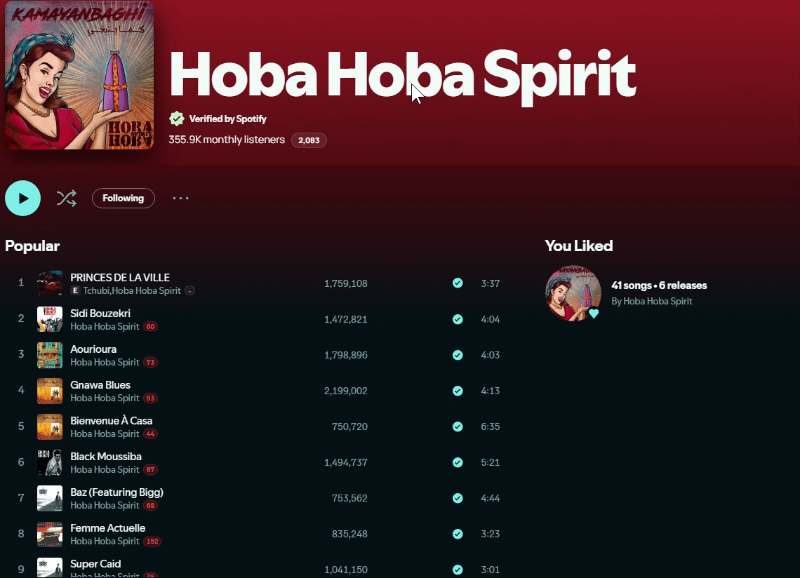
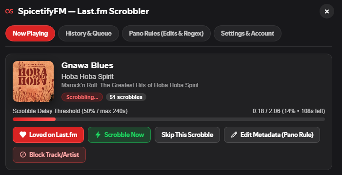

<p align="center">
  
</p>

# SpicetifyFM

<p align="center">
  <a href="https://github.com/rtZenith/SpicetifyFM/releases/latest"></a>
  <a href="https://github.com/rtZenith/SpicetifyFM/stargazers"></a>
  <a href="https://ko-fi.com/saadrt"></a>
  <a href="https://www.patreon.com/c/SaadRT"></a>
</p>

A pure **in-app Last.fm scrobbler** for Spotify via Spicetify, inspired by **Pano Scrobbler**. Runs 100% locally with **zero external desktop apps, browser extensions, or servers**.

<p align="center">
  
</p>

<p align="center">
  
</p>

## ✨ Features

- **🎵 Tracklist Scrobble Badges:** Compact Last.fm red playcount badges directly beside track artists in playlists, Liked Songs, and albums.
- **🎤 Total Artist Scrobbles:** View your all-time scrobble counts right inside artist page headers.
- **🎧 Player Bar Badge & Alt + L Dashboard:** Scrobble count pill in the bottom-left player bar and full dashboard via `Alt + L`.
- **🔐 Zero-Setup Web Auth:** Connect your Last.fm account directly in-app within seconds — no callback servers or password entry.
- **✏️ Saved Metadata Edits:** Override Track Title, Artist, or Album on the fly and save them automatically for future plays.
- **🧹 Pano Metadata Cleaners:** Strip `- Remastered`, `(Deluxe Edition)`, and custom regex find-and-replace rules.
- **🚫 Artist & Track Blocklist:** Prevent specific tracks or artists from ever scrobbling to your profile.
- **📁 Local Files & Offline Queue:** Full support for local MP3/FLAC files and automatic batch syncing when back online.

---

## 🚀 Installation

### 1. From Spicetify Marketplace (Easiest)
1. Open Spotify → Go to **Marketplace**
2. Search for **"SpicetifyFM"** → Click **Install**

### 2. PowerShell One-Liner (Windows)
```powershell
Invoke-WebRequest -UseBasicParsing "https://raw.githubusercontent.com/rtZenith/SpicetifyFM/main/spicetify-fm.js" -OutFile "$env:APPDATA\spicetify\Extensions\spicetify-fm.js"; spicetify config extensions spicetify-fm.js; spicetify apply
```

<details>
<summary><b>Manual Installation (Zip / Other OS)</b></summary>

1. Download **`spicetify-fm.js`** from [Releases](https://github.com/rtZenith/SpicetifyFM/releases/latest).
2. Copy it to your Spicetify Extensions folder:
   - **Windows:** `%appdata%\spicetify\Extensions\`
   - **macOS/Linux:** `~/.config/spicetify/Extensions/`
3. Run:
   ```bash
   spicetify config extensions spicetify-fm.js
   spicetify apply
   ```
</details>

---

## 🔑 Quick Setup (Takes 10 Seconds)

1. Press **`Alt + L`** (or click the Last.fm pill in the top bar) → open **Settings & Account**.
2. Click **`Get a free Last.fm API Key (takes 10s) ↗`** (opens Last.fm create app page).
3. Enter any app name (e.g. `SpicetifyFM`) and copy your **API Key** and **Shared Secret**.
4. Paste them into SpicetifyFM and click **"Connect with Last.fm (Web Auth)"** → approve in your browser. Done!

> [!TIP]
> If Spotify's native Last.fm connection is enabled in [last.fm/settings/applications](https://www.last.fm/settings/applications), disconnect "Spotify Scrobbling" there to avoid double-scrobbling.

---

<details>
<summary><b>📋 Changelog</b></summary>

### v1.0.2
- In-tracklist artist scrobble badges with zero CSS grid modification.
- Total artist scrobbles in artist headers.
- Prominent API key button in Settings.
- Sidebar isolation and React stability fixes.

### v1.0.1
- Native tracklist scrobble counts and bottom-left now playing badge.
- Virtualized IndexedDB playcount caching.

### v1.0.0
- Initial release: serverless desktop web auth, real-time scrobbler, saved metadata edits, regex cleaners, and offline queue.

</details>

---

## 💖 Support the Project

If you find **SpicetifyFM** useful, consider supporting future development:

- ☕ **Ko-fi:** [ko-fi.com/saadrt](https://ko-fi.com/saadrt)
- 🧡 **Patreon:** [patreon.com/c/SaadRT](https://www.patreon.com/c/SaadRT)
