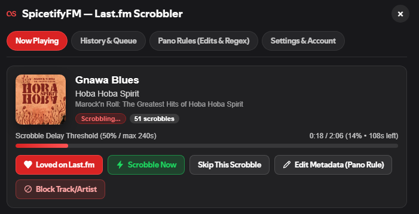
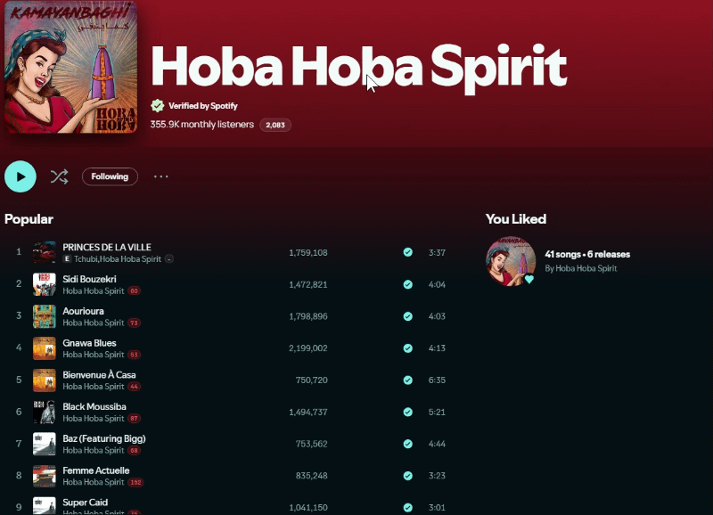

<p align="center">
  
</p>

# SpicetifyFM — In-App Last.fm Scrobbler for Spicetify

[](https://github.com/rtZenith/SpicetifyFM/releases/latest)
[](https://github.com/rtZenith/SpicetifyFM/stargazers)
[](https://www.last.fm/api)
[](LICENSE)
[](https://ko-fi.com/saadrt)
[](https://www.patreon.com/c/SaadRT)

A pure **in-app Last.fm scrobbler** extension for Spicetify, inspired by **[Pano Scrobbler](https://github.com/kawaiiDango/pano-scrobbler)** — requiring **zero third-party desktop apps, browser extensions, or external servers**.

Unlike Spotify's native server-side Last.fm connection (which frequently disconnects, ignores Local Files, and gives no visual feedback or metadata control), **SpicetifyFM** communicates directly with Last.fm's official API (`https://ws.audioscrobbler.com/2.0/`) inside the Spotify client.



---

## ✨ Features

- **🎵 Tracklist Scrobble Badges Beside Artist Name**:
  - Displays a compact, vibrant Last.fm red scrobble badge right beside the artist's name for every song in playlists, **Liked Songs**, and album views!
  - Non-intrusive, compact hitbox with instant click-to-open directly on Last.fm (`https://www.last.fm/music/<artist>/_/<track>`).
  - Zero CSS grid modification: 100% compatible with other extensions (e.g. **Producers**) and works seamlessly in both **List** and **Compact** view modes.
  - Fully virtualized with zero scrolling lag using local **IndexedDB** caching and automatic on-demand playcount fetching.
- **🎤 Total Artist Scrobbles in Header**:
  - Displays your total Last.fm scrobbles for any artist right next to their monthly listeners count in artist headers!
  - Automatically filters Spotify SEO tags and links directly to the artist's Last.fm profile.

<p align="center">
  
</p>

- **🎧 Bottom-Left Now Playing Scrobble Count Badge**:
  - Displays your exact Last.fm playcount for the currently playing track right next to the song title, artist, and Like/Add button in the bottom player bar.
  - One-click access to open the SpicetifyFM dashboard.
- **🔐 Serverless Desktop Web Auth Flow**: Connect your Last.fm account directly in-app (`auth.getToken` → click **"Yes, allow access"** on Last.fm → automatic in-app `auth.getSession` detection). No callback server or password entry required.
- **📊 Topbar Status Pill + Alt + L Dashboard**:
  - Shows live scrobble countdown (`0%` → `100%` → `Scrobbled ✓`), `Queued`, or `Blocked` status right in Spotify's top bar.
  - Quick keyboard shortcut: press **`Alt + L`** anywhere in Spotify to open or close the SpicetifyFM dashboard.
- **✏️ Pano Scrobbler-Style Saved Metadata Edits**:
  - Edit the **Track Title**, **Artist**, **Album**, or **Album Artist** of any song directly in the **Now Playing** tab.
  - Edits are saved in `localStorage` and automatically applied every time that song plays again!
- **🧹 Preset & Custom Regex Cleaners**:
  - Built-in toggles to strip `- Remastered 2011`, `(Deluxe Edition)`, `(Expanded Edition)`, `- Single`, and `(feat. ...)` tags.
  - **First Artist Only** mode: scrobble only the primary artist instead of combined multi-artist strings.
  - **Custom Regex Rules**: Define custom JavaScript regular expression find-and-replace rules for `track`, `artist`, `album`, or `all` fields.
- **🚫 Artist & Track Blocklist**:
  - Block specific tracks or artists (e.g., white noise, sleep tracks, study mixes) from ever scrobbling to your profile.
- **📁 Local Files & Repeat-One Support**:
  - Scrobbles local MP3/FLAC files (`spotify:local:...`) and accurately detects Repeat-One replays.
- **📡 Offline Queue & Auto-Retry**:
  - Automatically queues scrobbles in `localStorage` if you go offline or Last.fm is temporarily unreachable, and flushes them in batches when back online.

---

## 🚀 Installation

### One-Line PowerShell Install (Windows)

```powershell
Invoke-WebRequest -UseBasicParsing "https://raw.githubusercontent.com/rtZenith/SpicetifyFM/main/spicetify-fm.js" -OutFile "$env:APPDATA\spicetify\Extensions\spicetify-fm.js"; spicetify config extensions spicetify-fm.js; spicetify apply
```

### From Spicetify Marketplace

1. Open Spotify
2. Go to **Marketplace**
3. Search for **"SpicetifyFM (Last.fm Scrobbler)"**
4. Click **Install**

### Manual Installation (GitHub Releases)

1. Go to **[Releases](https://github.com/rtZenith/SpicetifyFM/releases/latest)** and download **`spicetify-fm.js`** (or `SpicetifyFM-v1.0.2.zip`)
2. Copy `spicetify-fm.js` to your Spicetify Extensions folder:
   - **Windows:** `%appdata%\spicetify\Extensions\`
   - **macOS/Linux:** `~/.config/spicetify/Extensions/`
3. Run:
   ```bash
   spicetify config extensions spicetify-fm.js
   spicetify apply
   ```

---

## 🔑 Getting Your Free Last.fm API Key (Takes 10 Seconds)

SpicetifyFM runs 100% client-side inside your Spotify app with zero third-party servers:
1. Open SpicetifyFM settings (press **`Alt + L`** or click the Last.fm pill in the top bar).
2. Click the prominent **`Get a free Last.fm API Key (takes 10s) ↗`** button right at the top of the Settings modal (opens [last.fm/api/account/create](https://www.last.fm/api/account/create)).
3. On Last.fm's developer page, enter any Application Name (e.g. `SpicetifyFM`) and leave the Callback URL blank.
4. Copy and paste your **API Key** and **Shared Secret** into SpicetifyFM, then click **Save Keys**.
5. Click **"Connect with Last.fm (Web Auth)"** and click **"Yes, allow access"** in your browser — SpicetifyFM will automatically detect the authorization in seconds!

---

## 📋 Changelog

### v1.0.2
- **Tracklist Artist Scrobble Badges**:
  - Replaced the full-column injection with a compact, vibrant Last.fm red badge placed directly next to the artist's name (`[Artist Name] [18]`).
  - Small, non-intrusive hitbox with one-click direct access to the song's Last.fm page.
  - Zero CSS grid modification: 100% compatible with other extensions (e.g. **Producers**) and works in both **Compact** and **List** view modes.
- **Total Artist Scrobbles in Artist Header**:
  - Added your personal all-time scrobbles for any artist right next to their monthly listeners count on artist profile pages.
  - Smart name cleaner removes Spotify SEO prefixes (`"Verified by Spotify"`, `"Listen to..."`).
- **Prominent API Key Button**:
  - Transformed the "Get a free Last.fm API Key" link in settings into a high-visibility styled button with an external-link icon.
- **Performance & React Safety**:
  - Strictly scoped DOM queries to the main view to prevent any interference with sidebar navigation, `Liked Songs`, or React DOM reconciliation.

### v1.0.1
- Added tracklist scrobble counts and bottom-left player bar now-playing scrobble badge.
- Added virtualized IndexedDB playcount caching.

### v1.0.0
- Initial release: serverless desktop web auth, real-time scrobbler, saved metadata edits, regex cleaners, and offline queue.

---

## ⚠️ Important Tip
If you previously enabled Spotify's built-in Last.fm connection in your Last.fm settings ([last.fm/settings/applications](https://www.last.fm/settings/applications)), **disconnect "Spotify Scrobbling"** there so Spotify's servers don't double-scrobble alongside SpicetifyFM.

---

## 💖 Support the Project

If you enjoy **SpicetifyFM** and want to support future updates and Spicetify plugins:

- ☕ **Ko-fi:** [https://ko-fi.com/saadrt](https://ko-fi.com/saadrt)
- 🧡 **Patreon:** [https://www.patreon.com/c/SaadRT](https://www.patreon.com/c/SaadRT)

